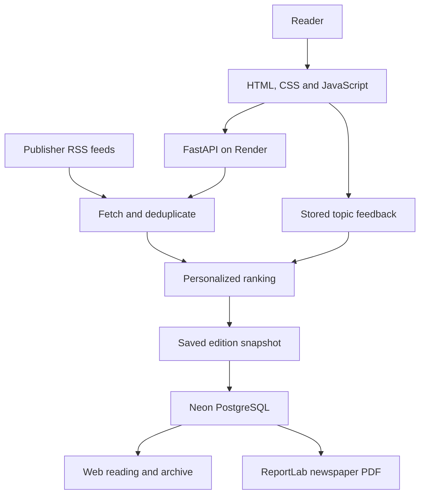

# Daybreak

A personal morning newspaper that adapts to reader interests
and explicit feedback.

## Live Demo

[Open Daybreak](https://daybreak-me60.onrender.com/)

The free hosting instance may take time to wake after inactivity.

## Features

- Onboarding with topics, specific interests, and reading budgets.
- RSS collection from BBC News, The Guardian, and NPR.
- Explainable ranking with freshness and source-diversity adjustments.
- Topic preference learning from positive and negative feedback.
- Daily edition reuse, fresh news collection, and feedback-based revisions.
- Persistent edition archives in Neon PostgreSQL.
- Two-column newspaper PDFs with original source links.

## How personalization works

Daybreak combines selected topics, keyword matches, article freshness,
and learned topic adjustments.

Feedback is stored per reader and article. Repeated feedback on the
same article replaces the earlier choice instead of accumulating votes.

Source diversity is encouraged during selection.
These are transparent ranking heuristics, not a trained recommendation model.

## Daily editions

The first visit of a new local day creates a fresh edition if a matching
one is unavailable.

- Open today's paper: reuse a matching saved edition.
- Refresh news: fetch current stories and save a new edition.
- Update this paper: rerank the saved candidate pool using current feedback.

Daily generation is triggered by a visit, not a background scheduler.

## Architecture



## Run locally

Requires Python 3.12+ and a PostgreSQL database.

Create a virtual environment, then install dependencies:

```bash
python -m venv .venv
```

Activate the environment using the command for your operating system.

```bash
python -m pip install -r requirements.txt
```

Create a `.env` file in the repository root:

```dotenv
DATABASE_URL=your_postgresql_connection_url
```

Start the application:

```bash
python -m uvicorn app.main:app --reload
```

Open http://127.0.0.1:8000.

Database tables are initialized on first database access.

## Deployment

- App hosting: Render
- Database: Neon PostgreSQL
- Build: `pip install -r requirements.txt`
- Start: `python -m uvicorn app.main:app --host 0.0.0.0 --port $PORT`
- Environment variable: `DATABASE_URL`

## Content and limitations

Articles are presented as publisher-provided RSS excerpts.
Original reporting remains available through attributed source links.

The current version does not generate AI summaries or independently
verify publisher claims.

Reader identity is stored in browser local storage. Clearing browser
data or switching browsers creates a different anonymous reader identity.

Feed availability varies. Duplicate removal checks URLs and normalized
titles; it does not fully cluster different reports about the same event.

Archives and feedback are stored in PostgreSQL and are independent
of the application's temporary hosting filesystem.