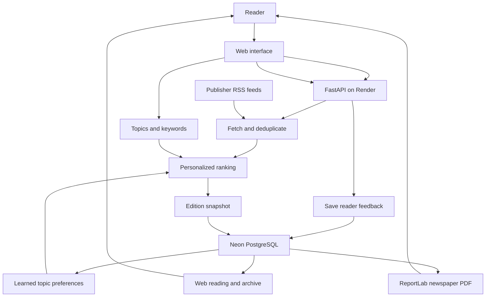

# Daybreak Architecture

Daybreak collects news from publisher RSS feeds, ranks stories
using reader preferences and feedback, and saves each edition
in Neon PostgreSQL.

The website and PDF export use the same saved edition.

## Main components

| Component | Responsibility |
|---|---|
| Web interface | Onboarding, reading, feedback and downloads |
| FastAPI | Handles requests and coordinates the application |
| RSS collection | Fetches publisher feeds and removes exact duplicates |
| Personalized ranking | Uses topics, keywords, freshness and learned preferences |
| Neon PostgreSQL | Stores editions and reader feedback |
| ReportLab | Creates a two-column newspaper PDF |

## Edition lifecycle

1. The reader selects interests and a reading budget.
2. The application reuses today's matching edition when available.
3. Otherwise, it fetches news and ranks the candidate stories.
4. The generated edition is saved as a snapshot.
5. The reader opens that snapshot on the website or downloads its PDF.

## Feedback learning

Positive and negative feedback update topic preferences.

Future editions use these preferences. The reader can also create
an updated revision from an existing edition's saved candidate pool.

Earlier saved editions remain unchanged.

## Implementation notes

- Daily generation happens on the reader's first visit, not on a scheduler.
- Personalization uses ranking heuristics, not a trained model.
- Article text consists of publisher-provided feed excerpts.
- Reader identity is stored in browser local storage.
- Database credentials are supplied through environment variables.